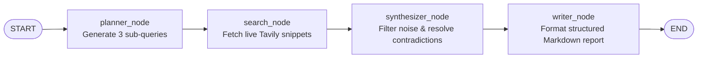

<div align="center">

# Autonomous Research Agent (`autonomous-research-agent`)

**An autonomous, multi-step AI research pipeline built with LangGraph, Google Gemini, and the Tavily Search API that turns any topic into a structured, publication-ready Markdown report.**

[](https://www.python.org/)
[](https://langchain-ai.github.io/langgraph/)
[](https://ai.google.dev/)
[](https://tavily.com/)
[](https://jupyter.org/)
[](https://opensource.org/licenses/MIT)

</div>

---

## Table of Contents

- [Project Overview](#project-overview)
- [Tech Stack](#tech-stack)
- [Architecture & Workflow](#architecture--workflow)
- [Setup & Installation](#setup--installation)
- [Usage Example](#usage-example)
- [Repository Structure](#repository-structure)
- [Future Roadmap](#future-roadmap)
- [Contributing](#contributing)
- [License](#license)

---

## Project Overview

Manual online research requires planning queries, scanning multiple sources, filtering out low-signal content, reconciling conflicting claims, and formatting findings into a readable brief.

**`autonomous-research-agent`** automates that entire workflow as a deterministic, stateful graph. Given a single research topic, the agent:

1. **Plans** targeted search angles by decomposing the topic into focused sub-queries.
2. **Searches** the live web via the Tavily API to gather up-to-date evidence and snippets.
3. **Synthesizes** raw search results using Google Gemini—filtering noise, cross-checking sources, and resolving contradictory information.
4. **Writes** a structured, publication-ready Markdown report complete with headings, comparison tables, and clear sections.

---

## Tech Stack

| Component | Technology | Role in Pipeline |
| :--- | :--- | :--- |
| **Orchestration** | [LangGraph](https://langchain-ai.github.io/langgraph/) (`StateGraph`) | Manages shared agent state and deterministic node-to-node execution |
| **LLM Reasoning** | [Google Gemini](https://ai.google.dev/) (`ChatGoogleGenerativeAI`) | Query planning, noise filtering, contradiction resolution, and report drafting |
| **Web Retrieval** | [Tavily Search API](https://tavily.com/) (`langchain-tavily`) | Real-time, LLM-optimized web search and snippet extraction |
| **Environment** | `python-dotenv` | Loads API keys securely from a local `.env` file |
| **Interactive Runtime** | Jupyter Notebook & `IPython` | Step-by-step experimentation and rich Markdown report rendering |
| **Language** | Python 3.10+ | Core implementation |

---

## Architecture & Workflow

The agent is modeled as a linear **4-node LangGraph `StateGraph`**. Each node reads from and updates a shared typed state object as execution progresses from topic intake to final Markdown output.



### The 4 Nodes

1. **`planner_node`**
   - **Input:** `topic` provided by the user.
   - **Responsibility:** Uses `ChatGoogleGenerativeAI` to break down the overarching topic into **3 targeted sub-queries** designed to capture diverse angles (e.g., core concepts, recent developments, trade-offs/comparisons).
   - **Output:** Populates the list of planned search queries in the graph state.

2. **`search_node`**
   - **Input:** The 3 sub-queries generated by `planner_node`.
   - **Responsibility:** Executes real-time searches against the **Tavily Search API** for each sub-query and collects live web snippets, metadata, and source context.
   - **Output:** Appends raw retrieved search results to the graph state.

3. **`synthesizer_node`**
   - **Input:** Raw search snippets gathered by `search_node`.
   - **Responsibility:** Analyzes the collected material with the LLM to **filter out irrelevant noise**, deduplicate overlapping claims, and **resolve data contradictions** across competing sources.
   - **Output:** Produces a clean, verified synthesis ready for final formatting.

4. **`writer_node`**
   - **Input:** Synthesized findings from `synthesizer_node`.
   - **Responsibility:** Transforms the distilled insights into a **publication-ready Markdown report** organized with clear section headings, bulleted takeaways, Markdown tables, and cohesive narrative flow.
   - **Output:** Stores the final Markdown report in the graph state.

---

## Setup & Installation

### Prerequisites

- **Python 3.10+** installed on your system
- A **Google AI Studio API key** (`GOOGLE_API_KEY`) for Gemini
- A **Tavily API key** (`TAVILY_API_KEY`) for real-time web search

### 1. Clone the Repository

```bash
git clone https://github.com/<your-username>/autonomous-research-agent.git
cd autonomous-research-agent
```

### 2. Create & Activate a Virtual Environment (Recommended)

```bash
# Create virtual environment
python -m venv .venv

# Activate on macOS / Linux
source .venv/bin/activate

# Activate on Windows (PowerShell)
.venv\Scripts\Activate.ps1
```

### 3. Install Dependencies

```bash
pip install langgraph langchain-google-genai langchain-tavily python-dotenv ipython
```

### 4. Configure Environment Variables

Create a `.env` file in the root directory of the repository and add your API keys:

```env
GOOGLE_API_KEY=your_google_gemini_api_key_here
TAVILY_API_KEY=your_tavily_api_key_here
```

> **Security Note:** Never commit your `.env` file to version control. Ensure `.env` is listed in your `.gitignore`.

---

## Usage Example

Open `Autonomous_Research_Agent.ipynb` in Jupyter Notebook (or VS Code) and run the cells to compile the `StateGraph` into `workflow`.

Once compiled, invoke the autonomous research pipeline by passing a topic dictionary to `workflow.invoke(...)`:

```python
from dotenv import load_dotenv
from IPython.display import Markdown, display

# Load GOOGLE_API_KEY and TAVILY_API_KEY from .env
load_dotenv()

# Invoke the compiled LangGraph workflow
result = workflow.invoke({
    "topic": "The impact of solid-state batteries on electric vehicle adoption in 2026"
})

# Render the generated Markdown report in Jupyter
display(Markdown(result["report"]))
```

*(Adjust the final key—such as `result["report"]`—to match the output field defined in your graph state.)*

### Expected Execution Flow

1. `planner_node` generates 3 focused sub-queries around solid-state battery commercialization, cost/range benchmarks, and EV automaker timelines.
2. `search_node` queries Tavily in real time and retrieves current articles and data snippets.
3. `synthesizer_node` filters promotional noise and reconciles conflicting production forecasts.
4. `writer_node` returns a polished Markdown report complete with executive summary, structured sections, and comparison tables.

---

## Repository Structure

```text
autonomous-research-agent/
├── Autonomous_Research_Agent.ipynb   # Core LangGraph workflow & interactive notebook
├── .env                              # Local API credentials (not tracked in git)
└── README.md                         # Project documentation
```

---

## Future Roadmap

- [ ] **Iterative Reflection Loop:** Add a conditional edge after `synthesizer_node` to trigger follow-up searches if evidence coverage is insufficient.
- [ ] **Inline Citation & Source Verification:** Enforce clickable `[Source](url)` citations with automated link validation in `writer_node`.
- [ ] **Parallel Search Execution:** Fan out sub-queries concurrently using LangGraph's `Send` API for faster retrieval latency.
- [ ] **Configurable Research Depth:** Support `quick`, `standard`, and `deep` modes to dynamically adjust sub-query count and Tavily search depth.
- [ ] **Export Pipelines:** Export finished reports directly to `.md`, `.pdf`, or Notion/Google Docs.
- [ ] **Human-in-the-Loop (HITL):** Allow users to review and edit the 3 planned sub-queries before `search_node` executes.
- [ ] **CLI & FastAPI Wrapper:** Package the compiled graph behind a standalone Python CLI and REST/streaming endpoint.

---

## Contributing

Contributions, bug reports, and feature ideas are welcome!

1. Fork the repository.
2. Create a feature branch (`git checkout -b feature/your-feature`).
3. Commit your changes (`git commit -m "Add your feature"`).
4. Push to the branch (`git push origin feature/your-feature`).
5. Open a Pull Request.

---

## License

This project is open-source and available under the [MIT License](LICENSE).
